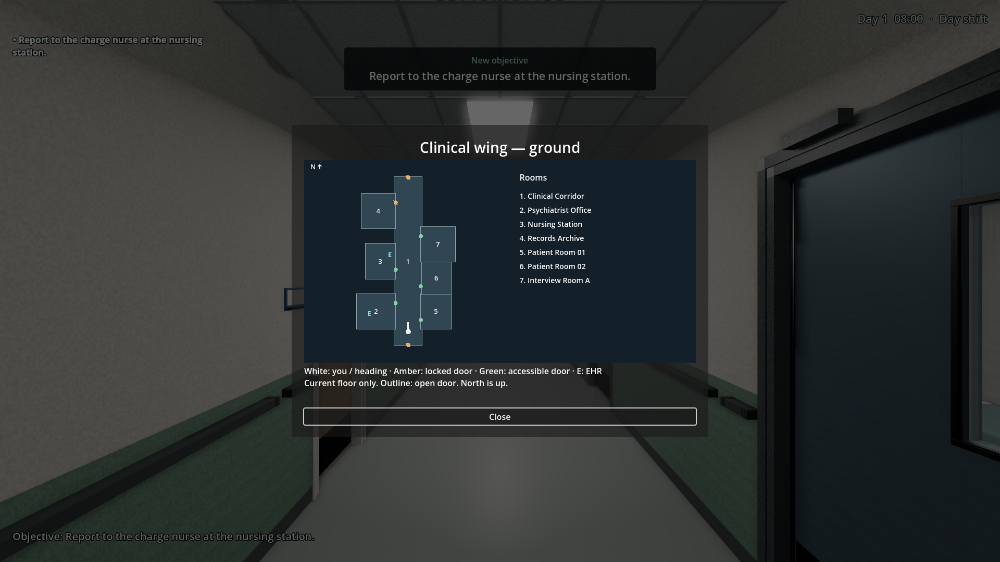
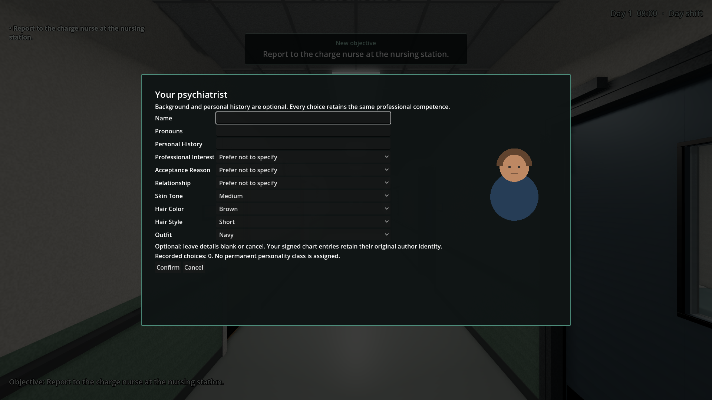
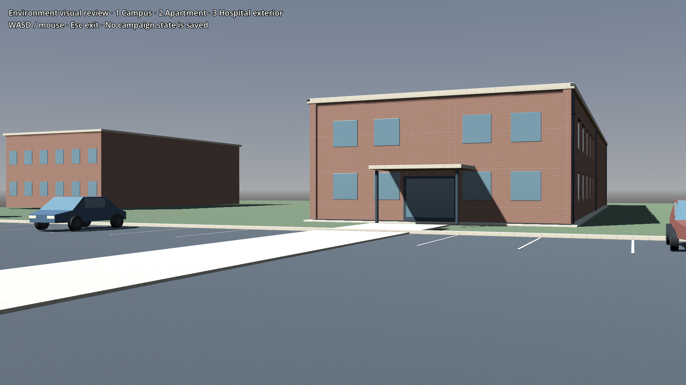
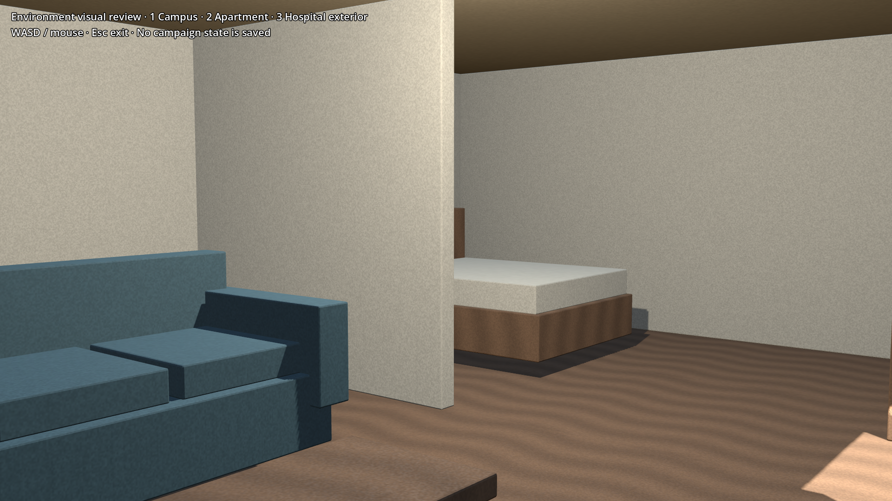
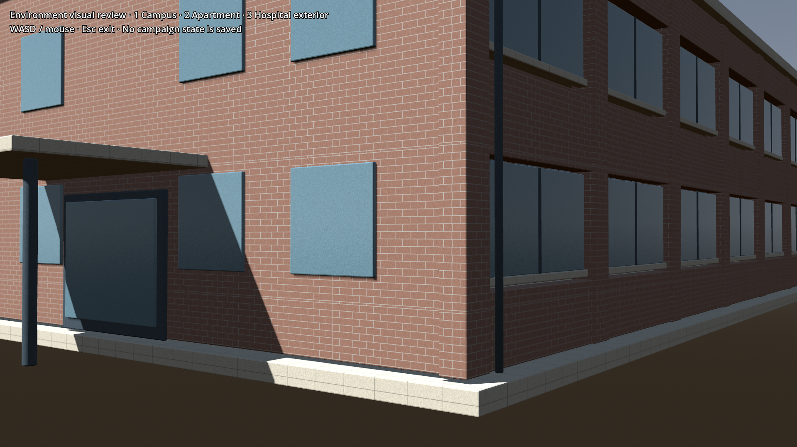

# Presentation decisions — 2026-10-20 candidate

This packet collects concrete candidates for owner review. No approval is inferred from implementation, a successful test, prior campaign approval or this document. Clinical approval is recorded separately in `clinical_review_log.md`.

Open [presentation_review.html](presentation_review.html) locally in a browser after checking out `codex/environment-finish`. It includes the exact five prologue plates and narration clips, both milestone plates, and all newer chapter voice lines with their exact wording. It uses existing offline media and sends nothing to an external service. To view transitions/timing, use the commands in [the Mac checklist](MAC_ACCEPTANCE_PLAYER_EXPERIENCE.md).

| Decision | Exact candidate | Current behavior |
|---|---|---|
| Prologue plates and narration | [five-panel sequence](../data/cutscenes/cs_ch01_prologue.json), [five narration lines](../data/narrative/prologue_ch1.json) | Preview only; absent from New Game until explicitly approved |
| First-assessment milestone | [seven-second split-screen definition](../data/milestones.json) | Preview only; campaign trigger disabled |
| Newer voice profiles and interview/narration text | [CH1](../data/narrative/voice_ch1.json), [CH2](../data/narrative/voice_ch2.json), [CH3](../data/narrative/voice_ch3.json), [CH4](../data/narrative/voice_ch4.json), [CH5](../data/narrative/voice_ch5.json), [Elias interview source](../data/narrative/interview_ch1.json); every clip available on the offline page | Integrated by earlier player-experience PRs; listening/content acceptance remains pending. Elias responses are narrated, not patient speech |
| Return-to-patient wording | [replacement dialogue](../data/dialogue.json) | Already integrated; later wording decision remains pending |
| EHR order wording | [order catalog](../data/order_catalog.json) | Existing assessment/referral catalog; medication/laboratory remain unavailable. Clinical wording needs explicit review |
| Title background use | [TitleScreen](../scripts/ui/TitleScreen.gd) reuses the unchanged approved Chapter 1 recap page 1 with dimming | Integrated; approval of the art did not automatically approve this later reuse |
| Environment appearance | Campus, facade and apartment candidates below | Campus grounds/finish materials in gameplay; apartment/facade in standalone review. Appearance and Mac performance unapproved |

## Current-floor map

## Optional psychiatrist profile

## Campus in Godot

## Apartment in Godot

## Facade in Godot

Godot screenshots use 4.7 stable on Linux X11, Compatibility renderer, Mesa llvmpipe. Blender asset plates on the offline page use 4.3.2 Cycles. Neither establishes acceptance on the owner's Godot 4.7.2 / Blender 5.2.2 Mac environment.

Report approve / revise / defer separately for the rows above. Activation of a prologue or milestone requires a recorded owner decision and its exact source flag/test update. The Jordan case has a separate [clinical activation packet](CP001_ACTIVATION_REVIEW.md); its identity is already confirmed as the same Chapter 1 Jordan, but its clinical content remains pending.
