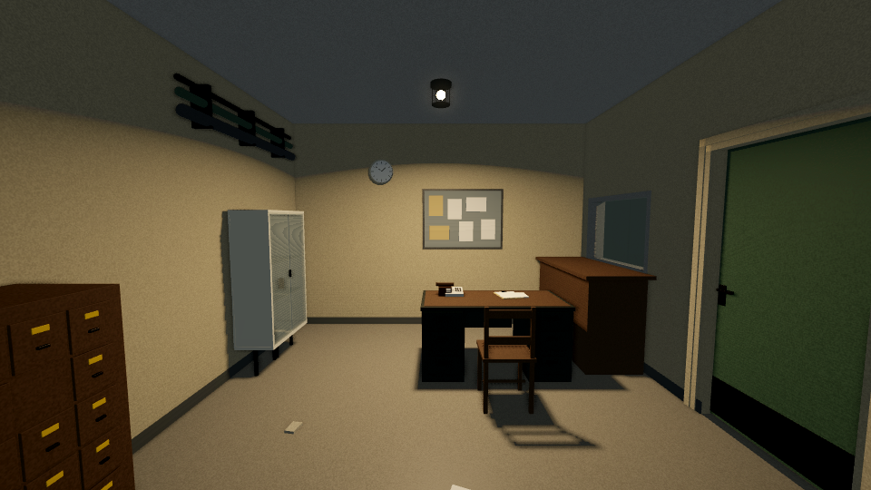
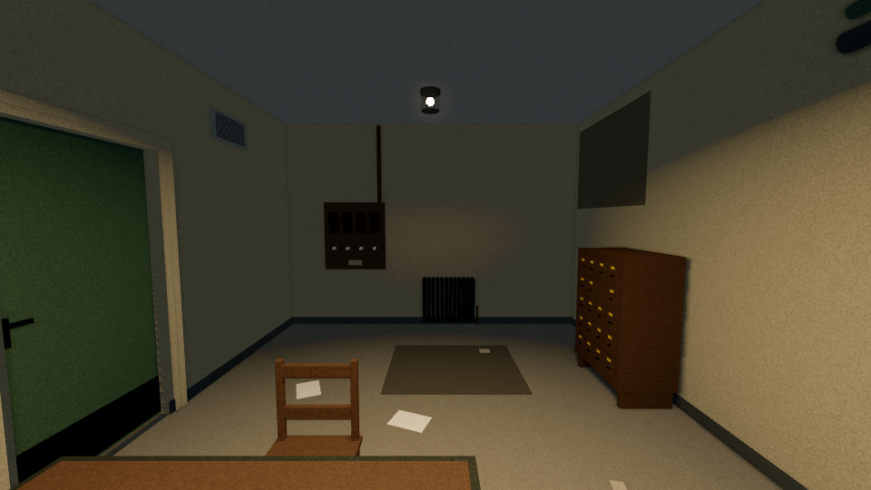

# Abandoned nursing station — placement review

Original Godot 4.7 engine captures, 960×540, Linux Mesa llvmpipe Compatibility.
**Placement evidence only; Mac / Forward+ appearance remains untested.**
[Source checkpoints, settings and hashes](capture_manifest.json).

[Before](atmosphere_before_abandoned_nursing_station.png) · [After](atmosphere_after_abandoned_nursing_station.png) · [Reverse](atmosphere_reverse_abandoned_nursing_station.png)

The high service pipes sit above the instrument cabinet. The census board,
clock, desk, night report, counter, hatch and door remain in their authored places.

The reverse view shows the wall grille and fuse board. Automated mesh checks
confirm the three new fixtures fit wholly inside the room and do not intersect
the existing story objects or protected furniture. They add no collision,
interaction, state, light or sound.

All three remain `PENDING_OWNER_VISUAL_REVIEW`.
[Production notes and source provenance](../../handoffs/2026-11-06_codex_abandoned_nursing_station.md).
