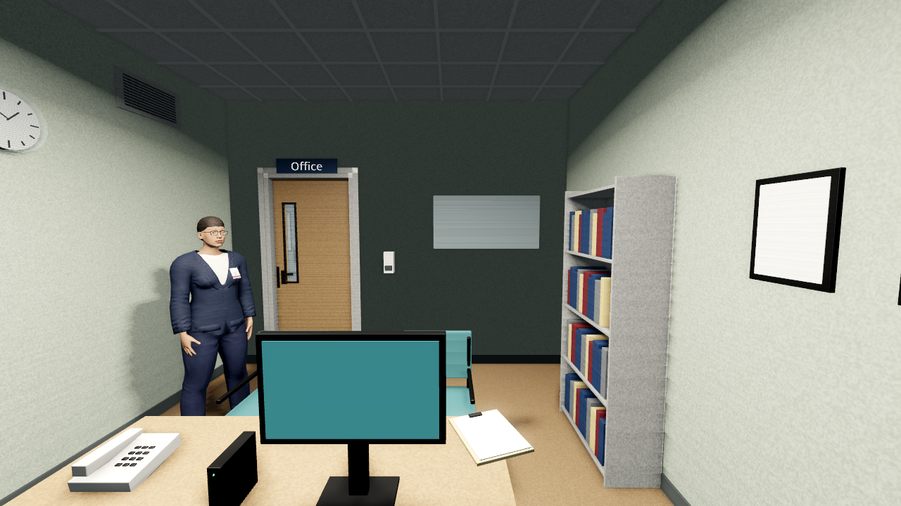
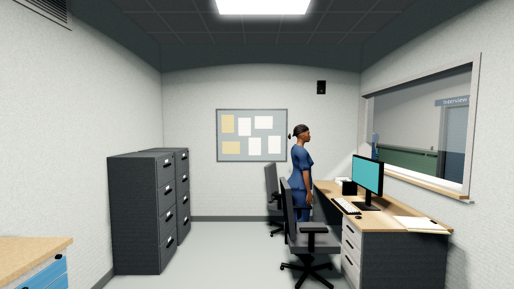

# Clinical room detail — placement review

Original engine screenshots, 1280×720, Godot 4.7 stable, Linux Mesa llvmpipe
Compatibility. **Not Mac / Forward+ acceptance.** Source/provenance and hashes:
[capture manifest](capture_manifest.json).

## Office

[Before](atmosphere_before_psychiatrist_office.png) · [After](atmosphere_after_psychiatrist_office.png)

The east-wall acoustic panel and gel dispenser keep clear of the door and
bookcase. The north-wall panel is outside this camera view; its placement was
checked against the source room layout and automated containment/door checks,
and still needs owner visual review.

## Nursing station

[Before](atmosphere_before_nursing_station.png) · [After](atmosphere_after_nursing_station.png)

The high vent is on the west wall; the intercom is above/right of the existing
notice board. The observation window, workstation and nurse remain unobstructed.

All five placements remain `PENDING_OWNER_VISUAL_REVIEW`. Full production notes:
[handoff](../../handoffs/2026-11-06_codex_clinical_room_detail.md).
