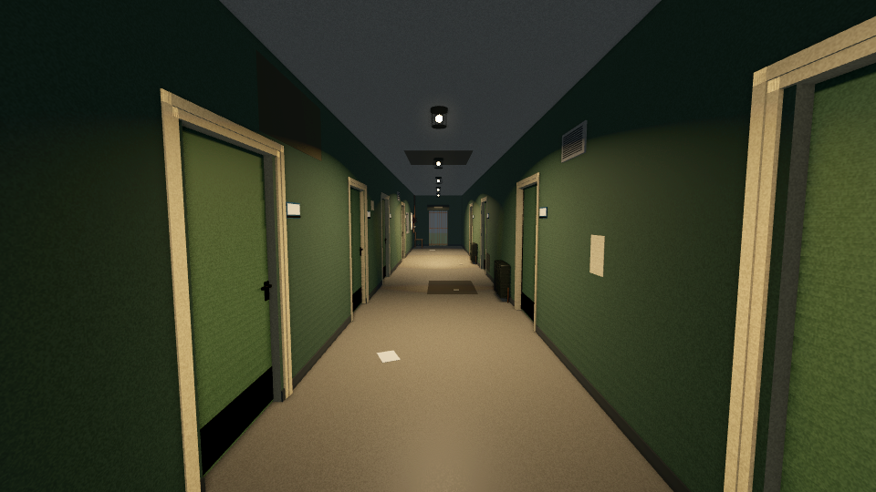
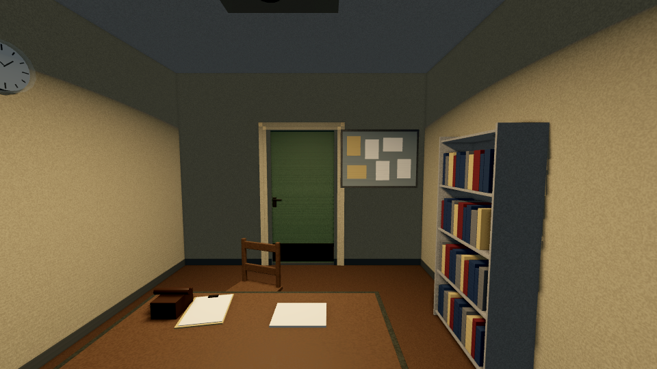

# Historic wing — placement review

Godot 4.7 stable, 960×540, Linux Mesa llvmpipe Compatibility renderer.
**Placement evidence only; not Mac / Forward+ acceptance.**
[Source checkpoints, settings and hashes](capture_manifest.json).

## Historic corridor

[Before](atmosphere_before_historic_corridor_24m.png) · [After](atmosphere_after_historic_corridor_24m.png)

High wall grilles and two original historic fuse panels stay away from doors,
windows and the lift gate. The entrance panel is behind this original camera. An additional
[reverse corridor view](atmosphere_reverse_historic_corridor_24m.png) shows the
other end. Automated checks cover all five props, including mesh ceiling/floor
clearance.

## Disused admin office

[Before](atmosphere_before_disused_admin_office.png) · [After](atmosphere_after_disused_admin_office.png)

Blank notices sit beside the door, clear of its opening and the existing
bookcase, clock, desk and authored document. They carry no wording or interaction.

All new placements remain `PENDING_OWNER_VISUAL_REVIEW`. No existing story
objects were altered. [Production notes](../../handoffs/2026-11-06_codex_historic_detail.md).
